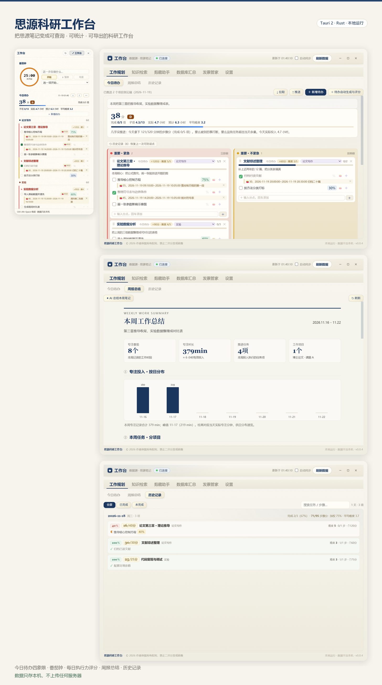
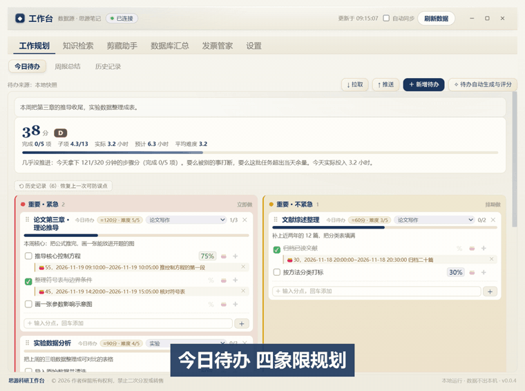
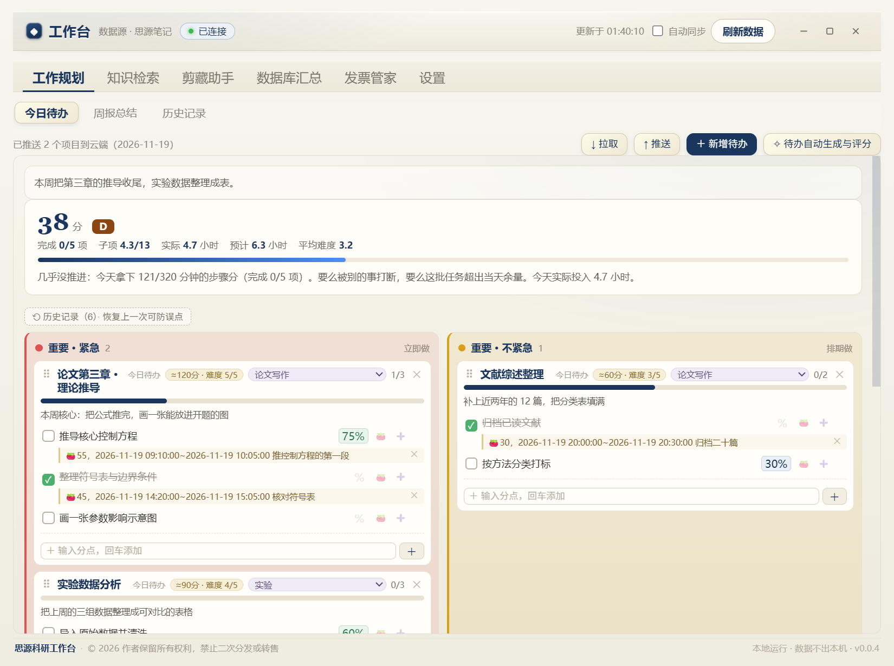
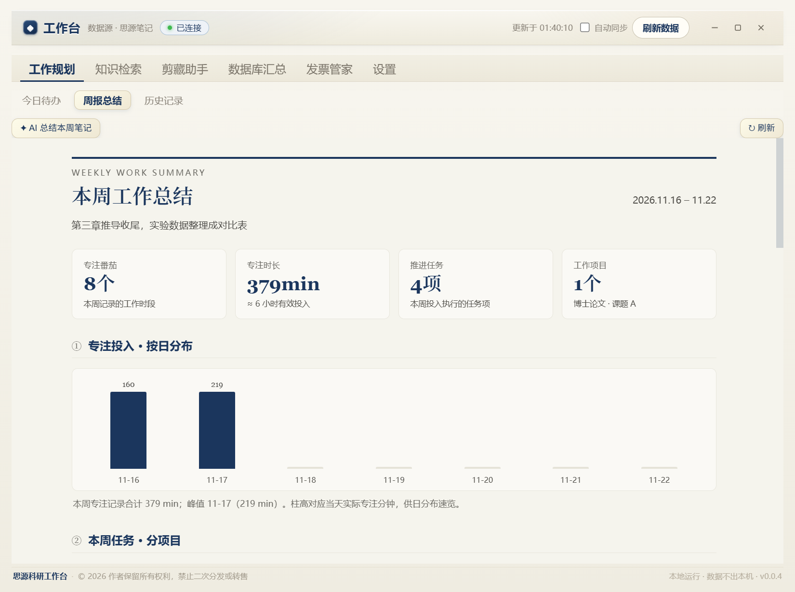
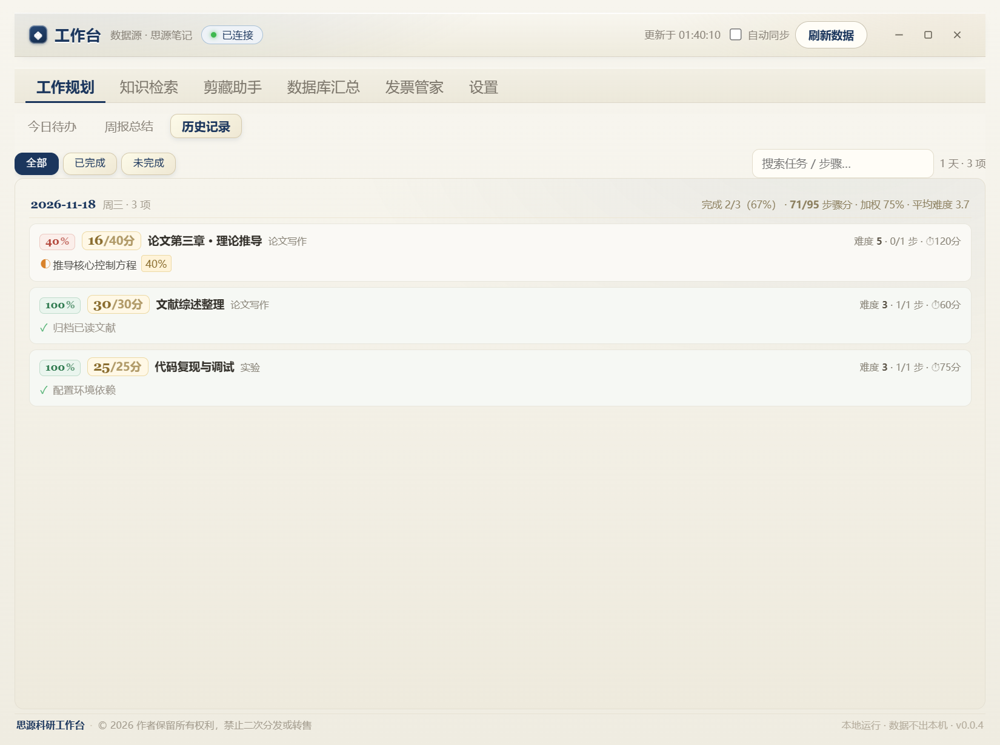
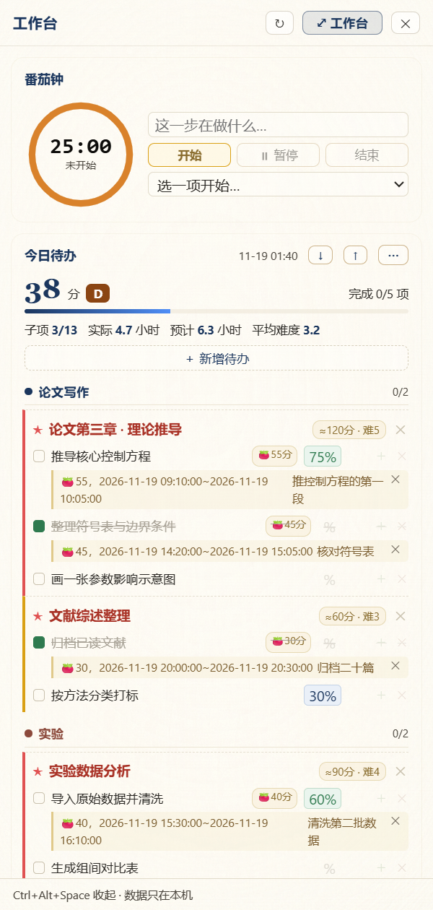

# 思源科研工作台

把 [思源笔记](https://b3log.org/siyuan/) 变成可查询、可统计、可导出的科研工作台：
待办规划、番茄钟、每日执行力评分、周报总结、知识图谱与文档检索。

Tauri 2 + Rust 桌面外壳，前端为内嵌的静态 HTML（无需 Node 运行时）。





---

## 你可能也这样

**「这周干了啥？」——答不上来。**

周一推了个模型，周二跑崩了两次，周三调通一半，周四改方案，周五又回去补数据。
到周末写周报，只记得「这周挺忙的」，具体推进了多少、卡在哪、哪天花得最多——全凭印象。

**干了一半的活，等于没干。**

一个推导卡在那个积分上三个小时。晚上回头看这一天，待办列表全是未勾选，
进度条 0%，仿佛什么都没发生。但你明明推进了 60%。

**学习记录和待办列表是两个世界。**

笔记在思源里越堆越多，待办在某个 App 里，番茄钟又在另一个地方。
想知道「上周那篇文献到底读没读完」，得翻三个软件。

**每次写周报都像重新回忆一遍。**

翻 git log、翻聊天记录、翻笔记修改时间，拼拼凑凑凑出一段话，
发给导师之前还要斟酌是不是显得太虚。

---

## 这个工具解决的就是这些

| 痛点 | 这里的做法 |
|---|---|
| 不知道这周干了啥 | 周报自动汇总专注时长、按日分布、任务推进，直接发得出去 |
| 干了一半等于没干 | 每一步标完成百分比，做 60% 就记 60% 的分 |
| 分数怎么来的说不清 | 步骤分按「剩余额度」逐日记账，跨天不重复计分，历史可回溯 |
| 工具太散 | 待办、番茄钟、笔记、周报在同一个窗口，侧边栏常驻桌面 |
| 隐私顾虑 | 数据只存本机 localStorage + 你自己那台思源，不上传任何服务器 |

**它不替你努力，只是把「已经努力过」记下来。**

---

## 界面

### 今日待办 · 四象限规划

按「重要 / 紧急」分成四个象限，每条任务拆成可勾选的步骤，
每一步可以标记完成了百分之多少——做了一半的活也能记账。



### 周报总结 · 一眼看清这一周

专注番茄数、有效投入时长、按日分布柱状图、每日执行力评分，
自动汇总成一张可以直接发给导师的周报。



### 历史记录 · 每天都留下了什么

每个任务的完成率、实际拿到的步骤分、加权评分与平均难度，
按天归拢，随时回看。



### 侧边栏 · 常驻桌面右侧

毛玻璃质感，`Ctrl+Alt+Space` 随时呼出。
番茄钟、步骤进度、待办勾选都能在这里完成，和主窗口实时同步。



---

## 功能

| 模块 | 说明 |
|---|---|
| **今日待办** | 按项目分组的任务与步骤，支持插入/删除步骤、设置完成百分比 |
| **番茄钟** | 步骤级计时，自动写入思源文档；也支持手动补记 |
| **每日执行力** | 按「步骤分 ÷ 当日耗时」算效率，跨天按剩余额度记账不重复计分 |
| **历史记录** | 每天每个任务的完成率、步骤分、加权评分与平均难度 |
| **周报总结** | 专注时长、任务分布、AI 笔记总结、执行力趋势图（本周/上周对比） |
| **知识图谱** | 按笔记本聚合的文档网络，可查长期未修改/字数分布 |
| **剪藏助手** | 网页正文抓取 → Markdown → 直接写入思源 |
| **发票管家** | PDF 发票解析（外部拓展服务）→ 写入思源数据库 |
| **数据库汇总** | 思源数据库字段完整度体检 |

所有个人数据只存本机（localStorage + 思源笔记），不上传任何服务器。

---

## 架构

```
工作台（Tauri 2 / Rust）
├── 主窗口      前端 HTML 内嵌在 exe 里
├── 侧边栏      独立窗口，毛玻璃 + 置顶，Ctrl+Alt+Space 呼出
└── 后台服务
    ├── 3918  周报数据服务     进程内 Rust 实现（src/weekly.rs）
    ├── 3921  知乎搜索桥接     Python（随包分发）
    └── 3923  发票 PDF 解析    外部拓展服务（跑在服务器上，含 OCR）
```

### 评分口径

所有视图（主界面、侧边栏、历史记录、周报）共用同一套算法：

```
单步分值 = 任务预估工时 ÷ 步骤数        （分值在第一次进入时钉住，之后改工时不影响历史账）
当日步骤分 = 从「剩余额度」里按当日推进比例取
效率     = 当日拿到的步骤分 ÷ 当日投入小时
```

举例：某步骤 20 分，第 1 天做到 60% → 拿 12 分，剩 8 分；
第 2 天补到 100% → 只能拿剩下的 8 分，不会重复计满。

---

## 开发

### 环境

```
Rust 1.77.2+
Node.js 20+（仅用于 @tauri-apps/cli，运行时不依赖）
```

### 常用命令

```bash
# 开发调试（热重载前端）
npm run dev

# 构建发布版
npx tauri build

# 生成图标
node make-icon.js
```

> **注意**：前端 HTML 会被嵌进 exe。修改 `frontend/*.html` 后如果直接 `cargo build`，
> 产物里仍是旧页面。必须走 `npx tauri build`，或先删掉 `src-tauri/target/*/build`。

### 目录

```
frontend/
  index.html              主窗口（5 个 script 块，注意作用域隔离）
  sidebar.html            侧边栏（单个 IIFE）
  siyuan-assistant.html   剪藏助手
src-tauri/
  src/main.rs             入口，窗口与服务启动
  src/sidebar.rs          侧边栏窗口、贴边吸附、毛玻璃
  src/weekly.rs           周报数据服务（Rust HTTP）
  src/services.rs         外部脚本服务托管
  src/siyuan.rs           思源 API 桥接
  src/dragdrop.rs         系统拖放
services/
  weekly-summary.html     周报模板
  zhihu_bridge.py         知乎桥接
  bin/zhihu-cli.exe       知乎命令行工具
  README.md               服务部署说明
```

---

## 配置

首次启动后，在「设置」页填写：

| 配置项 | 位置 | 说明 |
|---|---|---|
| 思源内核地址 / Token | 设置 → 数据源 | 默认 `http://127.0.0.1:6806` |
| AI 接口 / 模型 / Key | 设置 → AI 待办引擎 | OpenAI 兼容接口 |
| 周报数据源 | 设置 → 周报数据源 | 想读服务器上的笔记时填 |
| 发票解析服务 | 设置 → 拓展服务 | 外部服务地址 |

**所有凭据只存在本机 localStorage**，代码里不含任何 token。

---

## 发布

```bash
npm run check-version    # 先确认 6 处版本号一致
npx tauri build
# 产物：src-tauri/target/release/bundle/nsis/*.exe
```

安装包为 `currentUser` 模式，无需管理员权限。

### 版本号规则

| 改动量级 | 变化 | 谁来定 |
|---|---|---|
| 小改动（修 bug、加小功能） | 补丁位 +1：`0.0.2 → 0.0.3` | 每次改完自动升 |
| 中等更新 | 次版本位 +1：`0.0.x → 0.1.0` | 由用户提示 |
| 大版本 | 主版本位 +1：`0.x.x → 1.0.0` | 由用户提示 |

版本号散落在 6 个位置，改完务必跑 `npm run check-version`。详见 [VERSION.md](VERSION.md)。

### 外部服务依赖

| 服务 | 是否随包 | 说明 |
|---|---|---|
| 周报 3918 | ✅ 内嵌 | Rust 实现，零依赖 |
| 知乎 3921 | ✅ 随包 | 需要目标机装 Python |
| 发票 3923 | ❌ 外部 | 跑在服务器上，含 OCR，依赖较大 |
| 剪藏抓取 | ❌ 外部 | 依赖 Playwright + Chromium，前端会回落到 r.jina.ai |

---

## 许可证

© 2026 作者保留所有权利，禁止二次分发或转售。
